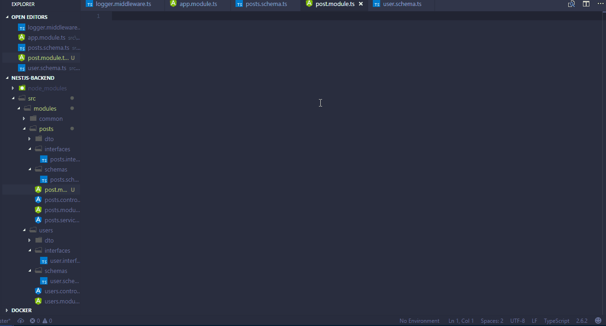

### vscode-nestjs-snippets

  
  <h1 align="center">NESTJS SNIPPETS FOR VSCODE</h1>
  
Adds snippets common operations for working with nestjs in Vscode.

## Screenshot

## Usage
| Snippet | Prefix | Purpose |
| --- | --- | --- |
| Nest Controller | n-controller | NestJS Controller |
| Nest Root Module | n-module-root | NestJS Root Module |
| Nest Dynamic Module | n-dynamic-module | NestJS Dynamic Module Implementing NestModule |
| Nest NestModule | n-module-nest | NestJS Module Implementing NestModule |
| Nest Mongoose Service | n-mongoose-service | NestJS Service for Mongoose |
| Nest Mongoose Interface | n-mongoose-interface | NestJS Interface for mongoose |
| Nest Unit Test | n-test | NestJS Unit Test |
| Nest Service Unit Test | n-test-service | NestJS Service Unit Test |
| Nest Sequelize Entity | n-sequelize-entity | NestJS Sequelize Entity |
| NestJS Validation Class | n-dto | Create a validation class using class-validator for a NestJS application |
| Nest Sequelize Provider | n-sequelize-provider | NestJS Sequelize Provider |
| Nest Sequelize Database Provider | n-sequelize-database-provider | NestJS Sequelize Provider |
| Nest Interceptor | n-interceptor | NestJS Interceptor |
| Nest Guard | n-guard | NestJS Guard |
| Nest Provider | n-provider | NestJS Provider |
| Nest Module | n-module | NestJS Module |
| Nest Global Module | n-module-global | NestJS Global Module |
| Nest Middleware | n-middleware | NestJS Middleware |
| Nest Pipe | n-pipe | NestJS Pipe |
| Nest Custom Decorator | n-decorator | NestJS custom decorator |
| Nest Custom Exception | n-exception | NestJS Custom Exception |
| Nest Custom Logger | n-logger | NestJs Custom Logger |
| Nest Jwt Implementation | n-jwt | NestJs Jwt Implementation |
| Nest TypeORM Entity | n-typeorm-entity | NestJS TypeORM Entity |
| Nest TypeORM Repository | n-typeorm-repository | NestJS TypeORM Repository |
| Nest Crud Controller | n-crud-con | Adds All HTTP Methods |
| Nest Put Request | n-put | Adds Put HTTP Methods |
| Nest Get Many Request | n-get-many | Adds Get HTTP Method |
| Nest Get One Request | n-get | Adds Get for Single Id |
| Nest Post Request | n-post | Adds Post HTTP Method |
| Nest Delete Request | n-delete | Adds Delete HTTP Method |
| Nest Cron | n-cron | Create new task class with cron method for NestJS |
| Nest CQRS Query | n-cqrs-query | NestJS CQRS Query |
| Nest CQRS Query Handler | n-cqrs-query-handler | NestJS CQRS Query Handler |
| Nest CQRS Command | n-cqrs-command | NestJS CQRS Command |
| Nest CQRS Command Handler | n-cqrs-command-handler | NestJS CQRS Command Handler |
| Nest single file upload | n-file-single | Nest single file upload |
| Nest multiple file upload | n-file-multi | Nest multiple file upload |
| Nest Mikrorm Entity | n-mikro-entity | NestJS Mikroorm Entity |
| Nest Mikoorm Repository | n-mikroorm-repository | NestJS Mikoorm Repository |

## Installation

1.  Install Visual Studio Code 1.10.0 or higher
1.  Launch Code
1.  From the command palette `Ctrl`-`Shift`-`P` (Windows, Linux) or `Cmd`-`Shift`-`P` (OSX)
1.  Select `Install Extension`
1.  Choose the extension
1.  Reload Visual Studio Code

OR

1.  Type `Ctrl`-`Shift`-`P` (Windows, Linux) or `Cmd`-`Shift`-`P` (OSX)
1.  Type `ext install rubiin.nestjs`

## Contributing

Contributions are highly welcome

## Release Notes

## 1.5.0 - 05-06-2020
